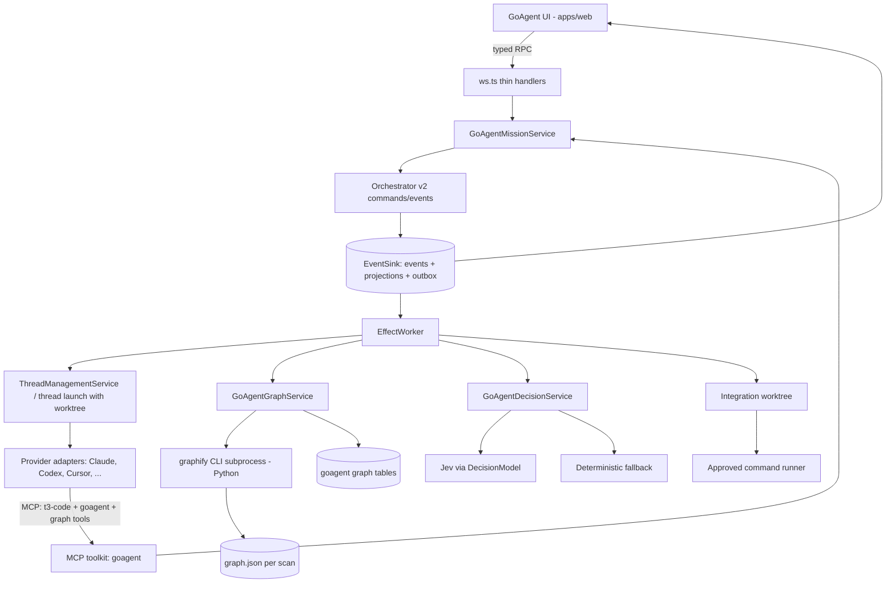

# GoAgent — Product Requirements & Technical Design

**Version:** 1.0 | **Date:** 2026-10-22 | **Status:** Proposed — nothing in this document is implemented yet
**Foundation:** Fork of [`pingdotgg/t3code`](https://github.com/pingdotgg/t3code) (local copy: `t3code-main/`)
**Knowledge graph engine:** [Graphify](https://github.com/Graphify-Labs/graphify) `graphifyy` v0.9.x (local copy: `graphify-8/`)
**Decision model:** Jev (TypeSafe System One) via `@effect/ai-typesafe` + Effect `DecisionModel`
**Supersedes:** `T3_Forge_Full_Technical_PRD_v2.md` (Forge's ideas carry over; Laya → Jev, custom scanner → Graphify, Backboard → optional)
**Tagline:** **Parallel coding agents that share one map of your code, decide in the open, and prove their work.**

> **For coding agents implementing this:** This is a specification, not proof that any API exists. Before changing the fork, read `t3code-main/t3code-main/AGENTS.md`, `docs/internals/overview.md`, `docs/orchestration-v2/*.md` and the actual source. Paths and method names marked *(verified)* were checked against the local checkouts on 2026-10-22; everything else is a proposal. Follow upstream patterns over names suggested here. Never fabricate agent activity, graph edges, decisions or test results.

---

## 0. TL;DR / build contract

GoAgent turns T3 Code into a **mission workspace**: the user describes a feature, GoAgent splits it into parallel tasks, runs each task as a real T3 agent thread in its own Git worktree, and shows everything in one screen:

- **Graphify** builds a source-backed knowledge graph of the repo (tree-sitter AST, local, no LLM for code). Agents query it instead of grepping; the UI shows it live and highlights what each agent changed.
- **Jev** makes the small, structured decisions in the loop — *single vs. parallel*, *which agent owns this failure*, *does this acknowledgment match this contract*, *how risky is this task* — with probabilities and confidence that are logged and visible.
- **T3 Code** supplies the hard parts that already exist: providers (Claude, Codex, Cursor, Grok, OpenCode…), worktree isolation, event-sourced persistence, checkpoints, MCP injection into every agent, and web/desktop UI.

**P0 — six demonstrable promises**

| # | Promise | Proof on screen |
|---|---|---|
| 1 | **Shared map** | Graphify graph of the repo; click an edge → file + line |
| 2 | **Parallel agents** | ≥2 real provider sessions in separate worktrees from the same base SHA |
| 3 | **Coordination** | Backend proposes an API contract, frontend acknowledges it; the gate visibly unblocks only after the matching-version ack |
| 4 | **Open decisions** | Each Jev decision shows its question, choice, probabilities, model version and whether a fallback was used |
| 5 | **Graph delta** | After agents finish, Graphify re-scans their worktrees and new/removed nodes and edges appear, tagged with the task that caused them |
| 6 | **Real verification** | Approved test command runs on the integrated worktree; real exit code and logs; failure is never shown as success |

**Not P0:** mobile UI, >3 parallel agents, auto-resolving merge conflicts, Graphify's LLM semantic pass over docs/PDF/video, Backboard, cloud runners, Neo4j, model training.

---

## 1. Problem and hypothesis

### 1.1 Problems
- Parallel agents work blind: each rediscovers the codebase by grepping and burns tokens doing it.
- Agents working on dependent parts (API ↔ UI) assume incompatible contracts.
- Routing and triage decisions ("parallelize this?", "whose bug is this?") are made silently inside a chat model and cannot be inspected.
- "Done" in a chat is not proof that the integrated code builds and passes tests.

### 1.2 Hypothesis
**A shared, source-backed code graph + explicit contract handoffs + small, inspectable decisions + real integrated verification** make multi-agent coding faster to trust than separate chats — without building a large autonomous swarm.

### 1.3 Users
- **Primary:** developers already using T3 Code who want to split a feature across agents.
- **Secondary:** teammates and hackathon judges who need to see *why* and *what happened*.
- **Not now:** enterprise admins, multi-tenant SaaS operators.

### 1.4 Differentiation
None of the pieces is novel alone. The value is the **traceable chain**: graph → plan → Jev routing → parallel agents → contract handoff → code change → graph delta → verification. Never claim an individual piece is new.

---

## 2. What we reuse (verified building blocks)

### 2.1 T3 Code — the host *(verified)*
- **Shape:** pnpm monorepo, TypeScript + Effect 4.0.5. `apps/server` (Node WebSocket server, orchestration, providers, git, MCP), `apps/web` (React/Vite), `apps/desktop` (Electron wrapper), `apps/mobile` (React Native), `packages/contracts` (Effect Schema wire types), `packages/client-runtime` (shared client state).
- **Core loop:** client → typed RPC → command → `orchestration-v2/Orchestrator.ts` (pure, no I/O) → `EventSink.ts` commits events + projections + receipt + outbox in one SQLite transaction → `EffectWorker.ts` runs side effects and feeds results back as commands.
- **Persistence:** `~/.t3/userdata/statev2.sqlite`; numbered migrations in `apps/server/src/persistence/Migrations/` (currently up to `067_*`).
- **Worktree isolation already exists:**
  - `t3_thread_launch` with `workspaceStrategy: { type: "worktree", baseRef, startFromOrigin }` or `{ type: "existing_worktree", worktreePath }` — a top-level thread in its own checkout.
  - `delegate_task` with `isolation: "worktree"` — a child thread in a separate checkout based on the parent's local commit (uncommitted edits are not copied).
  - `t3_worktree_list`, `t3_worktree_status`, `t3_worktree_handoff`, `t3_thread_merge_back`.
- **Agent ↔ app channel already exists:** an authenticated HTTP MCP server (`t3-code`, `http://127.0.0.1:<port>/mcp`) is injected into every Codex, Claude, Cursor, Grok and ACP session with a per-session scoped bearer token. Toolkits live in `apps/server/src/mcp/toolkits/<name>/{tools,handlers}.ts`.
- **Shared service boundary:** `ThreadManagementService` backs both WebSocket commands and MCP (thread lookup, send, wait, interrupt).
- **Project scripts:** `ProjectScript` in `packages/contracts/src/project.ts` — candidate home for approved verification commands.

**Consequence:** the riskiest item in the old Forge plan ("can a provider run in a separate cwd?") is solved upstream. GoAgent's mission service *drives existing thread/worktree services*; it does not spawn provider processes itself.

### 2.2 Graphify — the knowledge graph *(verified)*
- Python ≥3.10 package `graphifyy`, CLI `graphify`, Apache-2.0.
- Pipeline: `detect → extract → build → cluster (Leiden) → analyze → report → export`.
- **Code pass is local and deterministic:** tree-sitter across ~40 languages; extracts files, classes, functions, `imports`, `calls`, `inherits`, plus `# WHY:` / `# NOTE:` rationale nodes. `--code-only` skips the LLM semantic pass entirely.
- **Output:** `graphify-out/graph.json` (node-link JSON with `graph.schema_version` and `graph.graphify_version`), `graph.html`, `GRAPH_REPORT.md`.
- **Node:** `{id, label, source_file, source_location: "L42", ...}`. **Edge:** `{source, target, relation, confidence: EXTRACTED|INFERRED|AMBIGUOUS, confidence_score}`. Arc order is direction; load via `paths.load_node_link_graph()` semantics (honour `_src`/`_tgt`).
- **Diffs:** `analyze.graph_diff(G_old, G_new)` → `{new_nodes, removed_nodes, new_edges, removed_edges, summary}`.
- **Analysis:** `god_nodes`, `surprising_connections`, `find_import_cycles`, communities.
- **Agent access:** MCP server (`serve()` stdio, `serve_http(host, port, api_key, path="/mcp")`) with tools `query_graph`, `get_node`, `get_neighbors`, `shortest_path`, `god_nodes`, `get_community`, `graph_stats`, `get_pr_impact`.
- **Incremental:** `graphify update`, `graphify watch`, semantic cache.

### 2.3 Jev — the decision model *(verified API, unverified live behaviour)*
- Package `@effect/ai-typesafe` (vendored reference at `t3code-main/t3code-main/.repos/effect-smol/packages/ai/typesafe/`). Models: `jev-latest`, `jev-preview`, `jev-1.13.0`.
- Implements Effect's `DecisionModel` (`effect/ai`): define an input schema plus named decisions, then `DecisionModel.decide(definition, { input })`.
  - `Decision.classify({ instructions, criteria: { label: description } })` → label + probabilities + confidence
  - `Decision.rate({ instructions, criteria: [low, …, high] })` → ordered level
  - `Decision.probability({ instructions, criteria: { false, true } })` → likelihood
- Config: `TypeSafeClient.layerConfig()` reads `TYPESAFE_API_KEY`. No automatic retries; rate-limit errors carry retry delay. Probabilities arrive rounded to 2 decimals.
- Jev is **not** a coding agent, planner or executor. It answers bounded, structured questions.
- ⚠ **M0 check:** T3 pins `effect@4.0.5`; confirm the installed `effect` exports `effect/ai` `Decision`/`DecisionModel` and that `@effect/ai-typesafe` resolves against it. If not, add a thin HTTP client behind the same `GoAgentDecisions` service interface.

---

## 3. Scope and priority

| Priority | Feature | Acceptance bar |
|---|---|---|
| **P0** | GoAgent entry point | Existing T3 chat unaffected; a project gets a "GoAgent" view on web + desktop |
| **P0** | Graph index | Graphify `--code-only` on the project; nodes/edges stored with provenance; graph renders |
| **P0** | Graph for agents | Agents in a mission can query the graph via MCP |
| **P0** | Mission plan | Schema-valid plan of 2 parallel tasks (+ integrate + verify), editable, user-approved |
| **P0** | Jev routing | `single_agent` vs `parallel` decision with probabilities; deterministic fallback |
| **P0** | Parallel execution | Each task = real T3 thread in its own worktree from one base SHA |
| **P0** | Contract gate | Versioned contract propose → ack; dependent task blocked until matching ack |
| **P0** | Mission DAG + audit | Truthful states, causally linked persisted events, no fake percentages |
| **P0** | Graph delta | Per-task re-index + `graph_diff`, shown in UI with task attribution |
| **P0** | Integration + verification | Integration worktree, real approved command, real exit code |
| **P1** | Jev failure triage + one repair loop | Failure routed to owning agent; one retry; bounded |
| **P1** | Jev contract-match check | Probability that ack matches contract; low score → `needs_review` |
| **P1** | Project decisions (memory) | User-authored decisions stored locally, shown as `DECISION` graph nodes, injected into task prompts |
| **P1** | 3 parallel tasks | e.g. backend / frontend / tests |
| **P1** | Mission replay | Rebuild DAG + graph deltas from the event log |
| **P2** | Graphify semantic pass (docs/PDF/images) | Needs LLM key + cost control |
| **P2** | Backboard hosted memory, Render read-only viewer, mobile UI, Neo4j | Deferred |

**Freeze rule:** after the first green end-to-end mission, add no new framework or hosted service. Spend remaining time on reliability, error states and demo clarity.

---

## 4. User stories

- US-01 Index my repo and browse its modules, imports and calls with file/line evidence.
- US-02 Describe a feature and see why GoAgent chose one or several agents (Jev's answer + probabilities).
- US-03 Review and edit the plan before any agent runs.
- US-04 Watch parallel agents, each in its own worktree, and open any agent's full T3 thread.
- US-05 See why a task is blocked and which event unblocks it.
- US-06 Inspect the exact contract one agent sent and the other acknowledged.
- US-07 See what each agent changed in the graph.
- US-08 See real build/test output and exit code for the integrated result.
- US-09 Cancel a mission without touching my main checkout or orphaning processes.

---

## 5. Canonical demo

**Fixture repo** (committed separately, deterministic): React + Express + SQLite, existing JWT auth, profile page, `pnpm test` with Vitest. Seeded project decision: *"Use the existing JWT auth service; do not add a new auth provider."*

**Flow**
1. Launch the GoAgent fork, open the fixture project, open **GoAgent**.
2. Click **Index** → Graphify runs `--code-only`; graph shows `auth`, `routes/profile`, `ProfilePage` etc. Click an `imports` edge → `server/routes/profile.ts L3`.
3. Prompt: **"Add an authenticated edit-profile feature; keep the existing JWT auth."**
4. Jev routing card: `parallel` (p=0.87, model `jev-1.13.0`). Planner proposes `contract → backend ∥ frontend → integrate → verify`. User approves.
5. Two worktrees created at the same base SHA; two real agent threads start. Each agent's prompt includes the relevant graph neighbourhood and project decisions.
6. Backend agent calls `goagent_contract_propose` (`PATCH /api/profile`, body, response). Frontend agent calls `goagent_contract_ack` with version 1. DAG: frontend `blocked → running`.
7. Agents implement. Audit timeline shows real tool activity and changed files.
8. On task completion GoAgent re-indexes each worktree → graph delta: new `PATCH /api/profile` handler node, new `EditProfileForm` → `api/profile` edge, highlighted and labelled with their task.
9. Integration worktree: backend commit, then frontend commit; conflicts (if any) shown.
10. Approved `pnpm test` runs → command, duration, exit code, log excerpt.
11. (P1) Deliberate failing test → Jev triage picks `frontend` (p=0.78) → one repair round → re-verify.
12. Mission report: decisions taken, events, worktree commits, graph delta, verification result, open risks.

**Honesty rules:** the seeded decision is labelled as seeded; replays are labelled *recording*; nothing precomputed is shown as live.

**4-minute narrative:** 0:00 graph + evidence → 0:40 prompt + Jev routing + plan → 1:15 parallel agents + contract handoff → 2:00 graph delta → 2:40 integration + real tests → 3:30 audit chain + report.

---

## 6. UI

### 6.1 Entry
A **GoAgent** entry in the existing project view (web + desktop share it). Also reachable from the command palette (AGENTS.md "hit every surface"). Mobile shows nothing new in P0 and must not break.

### 6.2 Layout
- **Left nav:** Mission · Graph · Decisions · Audit · Verification
- **Header:** project, base SHA, active mission, connection state
- **Canvas:** Knowledge Graph or Mission DAG (`@xyflow/react`, new dependency — confirm with knip/license config)
- **Right inspector:** selected node / edge / task / decision / event / check, with provenance
- **Agent links:** each task links to its real T3 thread; GoAgent never duplicates transcripts

### 6.3 Knowledge Graph
- Read-only evidence graph. Default view = **module/file level**, collapsed by Graphify community; expand on click. Function-level nodes only on demand (keeps ≤ ~150 visible nodes).
- Evidence styling: `EXTRACTED` → solid (verified), `INFERRED` → dashed + score, `AMBIGUOUS` → warning style. Legend always visible.
- Filters: relation type, community, "changed in this mission", per-task delta. Search by label/file.
- Layout computed only on structural change; no continuously animating force layout (AGENTS.md: no GPU-pegging animation).

### 6.4 Mission DAG
Nodes: Route · Plan · Contract · Task(×N) · Integrate · Verify. States: `draft`, `queued`, `blocked`, `running`, `completed`, `failed`, `cancelled`, `needs_review`, `interrupted`. Each task node: agent/provider, worktree (sanitized), blocking dependency, timestamps, changed files, link to thread. No percentages.

### 6.5 Decisions panel (Jev)
Per decision: question key, input summary, criteria, chosen label/level, full probability distribution, confidence, model id, latency, `source: jev | fallback | human_override` and fallback reason. User can override; overrides are events.

### 6.6 Audit timeline
Server sequence, time, actor, recipient, type, summary, `causedBy`, sanitized payload. Filters by task/agent/type. Selecting `CONTRACT_ACKNOWLEDGED` highlights its `CONTRACT_PROPOSED` parent and the `TASK_UNBLOCKED` child.

### 6.7 Verification
Command (argv), cwd (integration worktree), start/end, duration, exit code, timeout flag, status, stdout/stderr excerpt, full log reference. Test counts only from a machine-readable reporter. Green only when exit 0 **and** all mandatory checks ran.

### 6.8 States that need real UI
No index yet · indexing · Graphify missing/failed · Jev unavailable (fallback active) · provider unavailable · worktree creation failed · plan invalid · task blocked · agent failed · integration conflict · test timeout · tests failed · cancelled · interrupted after restart.

---

## 7. Architecture

### 7.1 Diagram



### 7.2 Principles
1. **Reuse T3's command/event/outbox model.** Mission state changes are orchestrator commands and events; I/O (Graphify, Jev, git, tests) runs in effect-worker effects whose results come back as commands.
2. **Services, thin transports.** `ws.ts` handlers and MCP tools decode input, call one service method, map errors (AGENTS.md "Taste").
3. **Drive threads, don't spawn agents.** Each task is a T3 thread launched with a worktree strategy. GoAgent never execs provider CLIs directly.
4. **Graphify is a sidecar, not a library.** Run the `graphify` CLI as a captured child process; read `graph.json`. No Python embedded in Node.
5. **Jev decides, humans and code gate.** Jev output can route, suggest and flag. It never authorizes running commands, merging, or skipping verification.
6. **Event first, honest UI.** Persist before broadcast; UI derives everything from projections.
7. **Stable IDs, idempotent re-index.** Re-scanning the same SHA never duplicates graph rows or events.
8. **Adapters fail independently.** Graphify or Jev being down degrades the mission; it never corrupts it.

### 7.3 Proposed code locations *(proposal — follow upstream conventions)*

```text
apps/server/src/goagent/
  GoAgentMissionService.ts      # plan, approve, start, cancel, gates
  GoAgentPlanner.ts             # LLM plan → schema validation (uses existing textGeneration)
  GoAgentGraphService.ts        # graphify subprocess, ingest graph.json, diff, query
  GoAgentDecisionService.ts     # Jev definitions + fallback + logging
  GoAgentIntegrationService.ts  # integration worktree, cherry-pick/apply
  GoAgentVerificationService.ts # approved argv runner
  GoAgentContextBuilder.ts      # graph neighbourhood + decisions → task prompt
apps/server/src/mcp/toolkits/goagent/{tools,handlers}.ts
apps/server/src/persistence/Migrations/068_GoAgent*.ts
packages/contracts/src/goagent.ts   # schemas only, no runtime logic
apps/web/src/components/goagent/    # GoAgentShell, KnowledgeGraph, MissionDag, Inspector, AuditTimeline, VerificationPanel, DecisionCard
```

Effect functions use `Effect.fn("GoAgentMissionService.start")` style named spans.

---

## 8. Knowledge graph (Graphify integration)

### 8.1 Install and discovery
- Requirement: Python ≥3.10 and `graphify` on PATH (`uv tool install graphifyy`). Configurable path in server settings.
- On GoAgent open, the server probes `graphify --version`; missing → "Graphify not installed" state with install instructions. Never auto-install.

### 8.2 Index run
```text
graphify extract <root> --code-only   (output dir under GoAgent-managed data, not the user's repo)
```
- Run as a child process with captured PID, timeout, bounded output. Kill only that PID on cancel.
- Output directed into a GoAgent-managed directory per `(projectId, sha)` so `graphify-out/` is not written into the user's checkout. *(M0: confirm the CLI flag for output location; if absent, run in a temp copy or set cwd accordingly and move the output.)*
- Respect `.gitignore`; exclude `.env*`, keys, credentials, `node_modules`, build output.
- Only `--code-only` in P0: no repo text leaves the machine for graph building.

### 8.3 Ingest
- Parse `graph.json`; check `graph.schema_version` against a supported list; unsupported → explicit error.
- Restore edge direction from arc order / `_src`/`_tgt`.
- Upsert into GoAgent graph tables keyed by Graphify node id + project; edges keyed by `(source, target, relation)`.
- Map evidence: `EXTRACTED` → `verified_static`; `INFERRED` → `inferred` (keep `confidence_score`); `AMBIGUOUS` → `ambiguous`. User-authored decisions → `explicit_human`.
- Store `graphify_version`, `schema_version`, scan SHA, duration, counts as a `GRAPH_INDEXED` event.

### 8.4 Graph deltas per task
- When a task completes, run the same indexer on that task's worktree at its head commit.
- Compute the delta (Graphify's `graph_diff` semantics: new/removed nodes and edges) against the mission's base index. Implement the comparison in TypeScript over the two ingested snapshots, or call a small `graphify` diff command if one exists — decide at M0.
- Emit `GRAPH_DELTA` with `taskId`, counts and ids. UI highlights and filters by it.
- After integration, index the integration worktree; that becomes the new project baseline once verification passes.

### 8.5 Graph for agents
Two options, choose at M0:
- **A (preferred): GoAgent MCP tools** backed by the ingested graph — `goagent_graph_query`, `goagent_graph_node`, `goagent_graph_neighbors`, `goagent_graph_path`. One auth model (T3's MCP token), one data source, audit-logged.
- **B: Graphify's own MCP** (`serve_http` on a loopback port with `api_key`) added to each mission thread's MCP config. Faster to wire, but a second server, second auth and no audit.

### 8.6 Context builder
For each task, build a bounded context packet: the task's target files → their graph neighbourhood (1–2 hops, capped), relevant `# WHY:` rationale nodes, applicable project decisions, the current contract. Record which node ids and decision ids went in (`CONTEXT_BUILT` event) so the UI can show "what this agent was told".

---

## 9. Jev decisions

### 9.1 Decision catalogue

| Key | Kind | When | Input | Criteria | Effect of answer |
|---|---|---|---|---|---|
| `mission.route` | classify | after user prompt | request text, touched-area summary from graph, file counts | `single_agent`, `parallel` | chooses plan template; user can override |
| `mission.risk` | rate | after plan | plan, touched modules, god-node involvement | `low`, `medium`, `high` | `high` forces `needs_review` before start |
| `contract.match` *(P1)* | probability | on ack | contract + ack payload + frontend usage summary | `false`: mismatch, `true`: matches | below threshold → `needs_review`; never auto-unblocks by itself |
| `failure.owner` *(P1)* | classify | on failed verification | log excerpt, failing files, task ownership | task ids (`backend`, `frontend`, `tests`) + `unknown` | which agent gets the repair task |

Definitions live in `GoAgentDecisionService` as `Decision.make({ input: Schema, decisions: {...} })`. Inputs are summaries, never raw secrets or whole files.

### 9.2 Rules
- **Threshold + fallback:** each decision has a confidence threshold. Below it, or on any Jev error/timeout/missing key, use the deterministic fallback and record `source: "fallback"` and the reason.
  - `mission.route` fallback: `parallel` if the plan touches both client and server directories, else `single_agent`.
  - `mission.risk` fallback: `medium`.
  - `failure.owner` fallback: owner of the most-referenced failing file; else `unknown` → human.
- **Logged in full:** `DECISION_MADE` event with key, input summary hash, criteria, answer, probabilities, confidence, model id, latency, source.
- **Human override** is a separate `DECISION_OVERRIDDEN` event.
- **No authority:** a Jev answer never runs a command, merges, deletes, or marks verification as passed.
- **Budget:** max Jev calls per mission (default 10); short timeout (default 5 s); no automatic retries (the client doesn't retry, and we don't add any).
- **Evaluation before claims:** keep a small labelled set (≈20 routing prompts, ≈10 failure logs) and report observed accuracy vs. fallback. No accuracy claims without it.

### 9.3 Secrets
`TYPESAFE_API_KEY` lives only in server secret configuration (T3's `secrets`/`settingsSecrets`), never in the client bundle or events.

---

## 10. Mission orchestration

### 10.1 Plan contract
Planner (existing T3 text-generation path) returns JSON that must pass schema validation:

```json
{
  "title": "Authenticated profile editing",
  "constraints": ["Keep existing JWT auth"],
  "contract": { "method": "PATCH", "path": "/api/profile", "request": {}, "response": {} },
  "tasks": [
    { "id": "backend",  "role": "backend",  "ownsPaths": ["server/**"], "dependsOn": [] },
    { "id": "frontend", "role": "frontend", "ownsPaths": ["web/**"],    "dependsOn": ["contract:ack"] }
  ],
  "verification": ["fixture-test"]
}
```

Reject: cycles, unknown dependency ids, >2 parallel tasks in P0 (>3 in P1), verification ids not in the approved list, empty `ownsPaths`. `ownsPaths` is advisory guidance in the task prompt, not enforcement.

### 10.2 Starting tasks
- Require a clean base or show the dirty baseline explicitly; never touch user changes.
- Record base SHA. For each task, launch a T3 thread with `workspaceStrategy: { type: "worktree", baseRef: <base> }` through the same service `t3_thread_launch` uses (not via MCP from the server to itself).
- Choose **one provider** for the demo (decide at M0; Claude or Codex). Per-task provider override is P1.
- Persist mission/task/thread/worktree records **before** launch. Task prompt = task brief + context packet + contract instructions + "use goagent MCP tools to propose/acknowledge".
- Concurrency cap: 2 (P0), 3 (P1).

### 10.3 Contract handoff
- Backend (or planner) proposes via `goagent_contract_propose` → `CONTRACT_PROPOSED{contractId, version, payload}`.
- Dependent agent acknowledges via `goagent_contract_ack{contractId, version}` → `CONTRACT_ACKNOWLEDGED`.
- Gate opens only for a matching version. A new version invalidates older acks; dependent work is re-blocked until re-acked.
- If a dependent task is blocked before it starts, its thread is launched after the gate opens. If it is already running (it needed to read the contract), GoAgent sends the contract to its thread via the existing send path.
- (P1) `contract.match` Jev check runs on ack and can only *add* a `needs_review` flag.

### 10.4 Task completion
Completion = the thread's run settles (T3 run finalization) **and** the agent's work is committed in its worktree. If uncommitted changes remain, GoAgent asks the user before making a snapshot commit, and records it. Then: changed-file list → `TASK_COMPLETED` → per-task graph re-index (§8.4).

### 10.5 Integration
- Dedicated integration worktree from the base SHA under T3's worktrees directory.
- Apply task heads in dependency order (backend, then frontend) via cherry-pick.
- Conflict → stop, `INTEGRATION_CONFLICT` with files, mission `needs_review`. No auto-resolution in P0.
- Never force-push, reset or modify the user's main checkout. Merging into the user's branch is a separate explicit user action.

### 10.6 Cancel and restart
- Cancel = interrupt the mission's own threads through T3's interrupt path, stop GoAgent-owned child processes (Graphify, test runner) by captured PID. Never pattern-kill.
- On server restart, reconcile tasks against thread state. If uncertain, mark `interrupted` — never relaunch automatically.
- Worktrees are kept until the user approves cleanup (reuse T3's worktree cleanup UI where possible).

---

## 11. Verification and repair

- **Approved commands only:** from project scripts or a GoAgent config the user approved (`id`, `argv[]`, `cwd` relative to integration root, `timeoutMs`). Never shell text produced by an LLM or Jev.
- Spawn without shell interpolation where possible; capture bounded stdout/stderr, exit code, timing, timeout flag; store full log as an artifact referenced by id.
- Statuses: `PASSED` (exit 0, all mandatory checks ran), `FAILED`, `TIMED_OUT`, `NOT_RUN` — always distinct.
- Test counts only from Vitest/Jest JSON reporters; otherwise exit code + excerpt.
- Warn before running a repo's install scripts in an untrusted fixture.
- **Repair (P1):** on `FAILED`, `failure.owner` (Jev or fallback) picks the task; GoAgent sends a bounded repair brief (log excerpt, suspect files, contract) to that task's thread; re-integrate; re-verify. Max 1 loop.

---

## 12. Data model *(proposed; follow existing migration style)*

| Table | Key columns |
|---|---|
| `goagent_missions` | `mission_id`, `project_id`, `title`, `request`, `state`, `base_sha`, `plan_json`, `plan_version`, `created_at`, `updated_at` |
| `goagent_tasks` | `task_id`, `mission_id`, `role`, `state`, `thread_id`, `worktree_path`, `head_sha`, `depends_on_json`, `owns_paths_json`, `failure_reason` |
| `goagent_contracts` | `contract_id`, `mission_id`, `version`, `payload_json`, `proposed_by_task`, `proposed_event_id` |
| `goagent_contract_acks` | `contract_id`, `version`, `task_id`, `event_id`, `valid` |
| `goagent_decisions` | `decision_id`, `mission_id`, `key`, `source`, `model`, `answer_json`, `probabilities_json`, `confidence`, `fallback_reason`, `event_id` |
| `goagent_graph_scans` | `scan_id`, `project_id`, `sha`, `scope` (`base`/`task`/`integration`), `task_id`, `graphify_version`, `schema_version`, `node_count`, `edge_count`, `status` |
| `goagent_graph_nodes` | `project_id`, `node_id`, `label`, `kind`, `source_file`, `source_location`, `community`, `first_seen_scan`, `last_seen_scan` |
| `goagent_graph_edges` | `project_id`, `source_id`, `target_id`, `relation`, `evidence`, `confidence_score`, `first_seen_scan`, `last_seen_scan` |
| `goagent_project_decisions` *(P1)* | `decision_id`, `project_id`, `text`, `author`, `created_at`, `retired_at` |
| `goagent_verification_runs` | `run_id`, `mission_id`, `command_id`, `argv_json`, `status`, `exit_code`, `timed_out`, `started_at`, `ended_at`, `log_ref` |

Mission events go through T3's existing event store if its schema allows new aggregate/event types; otherwise a GoAgent event table with the same guarantees (unique id, per-mission sequence, committed in the same transaction as projections). Decide at M0. Persisted events must stay decodable on replay (overview.md).

---

## 13. Events

`MISSION_CREATED` · `DECISION_MADE` · `DECISION_OVERRIDDEN` · `PLAN_PROPOSED` · `PLAN_REJECTED` · `PLAN_APPROVED` · `TASK_QUEUED` · `TASK_BLOCKED` · `TASK_UNBLOCKED` · `TASK_STARTED` · `CONTEXT_BUILT` · `CONTRACT_PROPOSED` · `CONTRACT_ACKNOWLEDGED` · `CONTRACT_SUPERSEDED` · `TASK_COMPLETED` · `TASK_FAILED` · `GRAPH_INDEXED` · `GRAPH_DELTA` · `INTEGRATION_STARTED` · `INTEGRATION_CONFLICT` · `INTEGRATION_COMPLETED` · `VERIFICATION_STARTED` · `VERIFICATION_FINISHED` · `REPAIR_REQUESTED` · `MISSION_CANCELLED` · `MISSION_INTERRUPTED` · `MISSION_COMPLETED`

Every event: `eventId`, `missionId`, `sequence`, `occurredAt`, `actor` (`user` | `goagent` | `task:<id>` | `jev`), `causedBy`, sanitized `payload`.

**Mission states:** `draft → planned → approved → running → integrating → verifying → completed | failed | needs_review | cancelled | interrupted`
**Task states:** `queued → blocked → running → completed | failed | cancelled | needs_review | interrupted`

---

## 14. Contracts and MCP tools

### 14.1 Client RPC (via `createEnvironmentRpcCommand`, protected methods added to `CLIENT_GUARDED_RPC_SCOPES`)
- `goagent.graph.index({ projectId })` · `goagent.graph.get({ projectId, scope, scanId? })` · `goagent.graph.delta({ missionId, taskId? })`
- `goagent.mission.create({ projectId, request })` → routing decision + plan
- `goagent.mission.updatePlan` · `goagent.mission.approve({ missionId, planVersion })` · `goagent.mission.start` · `goagent.mission.cancel`
- `goagent.decision.override({ decisionId, answer })`
- `goagent.integration.begin` · `goagent.verification.run({ missionId, commandId })`
- Subscriptions: `goagent.mission.subscribe(missionId, fromSequence)`, `goagent.missions.list(projectId)`

### 14.2 Agent MCP toolkit `goagent` (scoped to the caller's mission thread)
- `goagent_graph_query`, `goagent_graph_node`, `goagent_graph_neighbors`, `goagent_graph_path`
- `goagent_contract_propose`, `goagent_contract_ack`, `goagent_contract_read`
- `goagent_task_status` (own task + dependencies only)
- `goagent_project_decisions` *(P1)*

Every tool checks the caller's thread belongs to the mission and task it names.

### 14.3 Errors
`PROJECT_NOT_FOUND` · `GRAPHIFY_UNAVAILABLE` · `GRAPHIFY_SCHEMA_UNSUPPORTED` · `GRAPH_INDEX_FAILED` · `DECISION_UNAVAILABLE` (fallback used) · `PLAN_SCHEMA_INVALID` · `TASK_DEPENDENCY_CYCLE` · `WORKTREE_DIRTY_BASE` · `WORKTREE_CREATION_FAILED` · `PROVIDER_UNAVAILABLE` · `CONTRACT_VERSION_MISMATCH` · `INTEGRATION_CONFLICT` · `VERIFICATION_NOT_APPROVED` · `VERIFY_TIMEOUT` · `MISSION_INTERRUPTED`. Structured, actionable, never only text.

---

## 15. Security, privacy, cost

- **Untrusted input:** repo content, Graphify labels, agent messages, test output and Jev answers. None of it can grant command execution, merging or credential access.
- **Rendering:** sanitize labels/logs; no executable HTML from agents.
- **Secrets:** redact env values and token patterns from events/logs before write; exclude secret files from indexing; `TYPESAFE_API_KEY` server-side only.
- **Data leaving the machine:** P0 Graphify is local-only (`--code-only`). Jev receives only short summaries — show a one-time notice before the first Jev call per project and allow disabling Jev (fallback only).
- **Processes:** capture PIDs; never `pkill -f`; never run a dev server against `~/.t3/userdata`; never set `VITE_HTTP_URL`/`VITE_WS_URL` (AGENTS.md).
- **Paths:** worktree and Graphify output paths canonicalized under managed directories.
- **Budgets per mission:** max agents, max task runtime, max verification runtime, max Jev calls, max repair loops. Show provider cost only if the provider reports it.

---

## 16. Performance and reliability targets (local fixture, not promises)

- Graph UI stays interactive at ~150 visible nodes / ~300 edges; larger graphs collapse by community.
- `--code-only` index of the fixture completes in seconds; large repos show progress from real counts only.
- Events reach the UI within ~1 s locally; reconnect replays from last sequence with no duplicates.
- Graphify or Jev outage never blocks viewing existing missions or graphs.
- Keep WebSocket payloads small: send graph deltas and paged nodes, not full graphs on every event (T3 performance rule).

---

## 17. Acceptance criteria

- **AC-01 Graph evidence:** fixture index shows ≥10 nodes and ≥5 `EXTRACTED` edges; clicking an edge shows a valid file + line.
- **AC-02 Idempotent index:** indexing the same SHA twice doesn't change counts; changing an import adds/removes the right edge.
- **AC-03 Graph for agents:** an agent's graph tool call appears in the audit and returns real nodes.
- **AC-04 Jev routing:** routing decision shows model id + probabilities; with Jev disabled or the key missing, fallback runs and is labelled.
- **AC-05 Plan validation:** cycle / unknown dependency / too many parallel tasks / unapproved command → rejected with a specific error.
- **AC-06 Parallel agents:** two threads, two distinct worktrees, same base SHA; main checkout unchanged; thread ids traceable.
- **AC-07 Contract gate:** dependent task stays blocked until a matching-version ack; a v2 contract invalidates the v1 ack.
- **AC-08 Graph delta:** after a task completes, the UI shows new nodes/edges attributed to it without a manual refresh.
- **AC-09 Integration safety:** integration happens in its own worktree; conflicts → `needs_review` with file list; main checkout untouched.
- **AC-10 Real verification:** non-zero exit never shows as pass; timeout is distinct; logs are inspectable.
- **AC-11 Cancel / restart:** cancel stops only mission threads and GoAgent child processes; restart marks unknowns `interrupted`, no duplicate launches.
- **AC-12 Honesty:** every status in the demo comes from backend state; seeded/replayed data is labelled.

---

## 18. Test plan

| Layer | Examples |
|---|---|
| Unit | plan schema + cycle detection, contract gate, decision fallback/threshold logic, graph.json ingest + direction restore, delta computation, context-builder caps |
| Persistence | migration, per-mission event sequence, replay equivalence, idempotent graph upsert |
| Integration | Graphify subprocess on fixture (skip with explicit reason if Python absent), worktree launch through the real thread service, contract ack over MCP, cherry-pick conflict |
| Fakes | `DecisionModel` test layer (Effect test pattern) — no live Jev in CI |
| Failure injection | Graphify missing, bad schema version, Jev timeout, agent failure, stale contract ack, merge conflict, exit 1, timeout |
| Security | path traversal, secret in log, prompt injection in README asking to run commands, foreign mission id in MCP call |
| UI | browser tests per AGENTS.md (`*.browser.test.tsx`, `await using screen = await render(...)`) for DAG state rendering and inspector |

Follow T3 test rules: no sleeps/polling/timeouts in tests; drain `OrchestrationEffectWorkerV2` or await persisted events. Run `vp run check:changed` and targeted `vp test run <files>`; no repo-wide checks.

---

## 19. Milestones (ordered by risk)

**M0 — Discovery & spikes**
- Run the fork in a worktree with seeded test data (`vp i`, `vp run dev`).
- Verify `effect@4.0.5` exposes `effect/ai` `Decision`/`DecisionModel`; make one real Jev call from a server script with `TYPESAFE_API_KEY`.
- Run `graphify extract --code-only` on the fixture; confirm output-location control, schema version and timing.
- Find the server-side entry that `t3_thread_launch` with `workspaceStrategy` calls; launch one thread in a worktree from code.
- Decide: event store reuse vs. GoAgent table; graph MCP option A vs. B; demo provider.
- Build the fixture repo with a passing `pnpm test`.
- **Exit:** written integration map (kept outside the repo per AGENTS.md) + one Jev answer + one Graphify graph + one worktree thread launched from server code.

**M1 — Parallel tasks + DAG**
- Contracts, migrations, `GoAgentMissionService`, two worktree threads, task states, Mission DAG UI.
- **Exit:** two real agents in two worktrees, truthful DAG.

**M2 — Contract gate + audit**
- `goagent` MCP toolkit (contract tools), gate logic, audit timeline with causal links.
- **Exit:** an ack from one agent unblocks the other, visible in UI and audit.

**M3 — Graph**
- Graph service, ingest, Knowledge Graph UI + inspector, graph MCP tools, context builder, per-task re-index + delta.
- **Exit:** agents query the graph; delta appears after a task.

**M4 — Jev + integration + verification**
- Routing + risk decisions with fallback and Decisions panel; integration worktree; approved command runner; verification panel.
- **Exit:** full end-to-end mission with real test evidence.

**M5 — Hardening / P1**
- Error states, `failure.owner` + one repair loop, `contract.match`, project decisions, replay, 3-task plans.
- **Exit:** three consecutive clean fixture demos, no destructive side effects.

### Cut strategy
- **~8 h:** graph index + UI + Jev routing card + one agent in a worktree. Present parallelism as next step — don't imply it works.
- **~16 h:** + two parallel agents + contract gate + DAG + real test.
- **~30 h:** + graph deltas, failure handling, Jev triage + repair loop.
- Never trade real execution for mockups.

---

## 20. Team split

- **A — Server/orchestration:** mission service, thread/worktree launch, gates, integration, cancel/restart.
- **B — Graph:** Graphify subprocess, ingest, deltas, graph MCP tools, context builder.
- **C — Decisions + verification:** Jev service, fallbacks, evaluation set, command runner, fixture repo.
- **D — UI:** GoAgent shell, Knowledge Graph, Mission DAG, Decisions, Audit, Verification panels.

Agree on `packages/contracts/src/goagent.ts` schemas and sample event/graph payloads **first**, so UI work doesn't wait on the backend.

---

## 21. Metrics (capture, don't invent)

Mission wall time · agent overlap time · contract unblock latency · graph nodes/edges by evidence type · graph tool calls per agent · tokens per task where the provider reports them · Jev decisions vs. fallbacks vs. overrides · Jev accuracy on the labelled set · tests run/passed/failed · conflicts · manual interventions.

**Stretch study:** same fixture feature with graph tools on vs. off, and one agent vs. two. Report as observed case studies, not general claims.

---

## 22. Risks and open decisions

| Risk | Sev. | Mitigation |
|---|---|---|
| `effect@4.0.5` lacks `effect/ai` DecisionModel or `@effect/ai-typesafe` mismatch | High | M0 spike; fallback to thin HTTP client behind the same service |
| Jev API unavailable / rate-limited / unverified rounding | Medium | Deterministic fallback, short timeout, decisions never gate safety |
| Python/Graphify not installed on user machine (Windows!) | High | Probe + clear install state; GoAgent missions still run without a graph (labelled) |
| Graphify can't write output outside the repo | Medium | M0 check; temp working copy or post-move |
| Graph too large for UI | Medium | Community collapse, file-level default, paging |
| Agents edit the same files | High | `ownsPaths` guidance, separate worktrees, explicit conflict review |
| Hidden coupling to T3 internals breaks on upstream update | High | Pin the fork commit; go through services (`ThreadManagementService`, thread launch), not internals |
| Agents ignore contract tools | Medium | Clear task prompt; gate still holds; planner-proposed contract as fallback |
| Test execution affects host | High | Fixture repo, approved argv, timeouts |
| Judges mistake replay for live | High | Labels; run the real mission live |

**Open decisions (settle in M0):**
1. Demo provider (Claude vs. Codex).
2. Reuse T3's event store for mission events, or a GoAgent table.
3. Graph access for agents: GoAgent MCP tools (A) vs. Graphify's MCP server (B).
4. Graph delta in TypeScript vs. a Graphify diff command.
5. Whether project decisions (memory) are P0 for the demo or stay P1.
6. Fixture stack and approved verification commands.

---

## 23. Pitch

**One line:** "GoAgent runs parallel coding agents inside T3 Code that share one live, source-backed map of your codebase, make their routing decisions in the open, and prove the merged result with real tests."

**30 seconds:** "Parallel coding agents are fast but blind — each one re-greps the repo, they guess each other's APIs, and 'done' just means the chat ended. GoAgent builds on T3 Code. Graphify turns your repo into a knowledge graph every agent can query. Jev makes the routing and triage calls with probabilities you can inspect. Agents run in isolated worktrees, hand off an API contract that actually gates work, and when they finish you see exactly what changed in the graph and whether the integrated code passes real tests."

**Judge proof points**
1. Click any graph edge → real file and line.
2. Jev's routing decision with its probability distribution and model version.
3. Two real agents, two worktrees, same base commit.
4. A versioned contract ack unblocks the dependent agent.
5. The graph delta each agent caused.
6. Real tests on the merged result — failures shown as failures.

---

## 24. Coding agent bootstrap

> You are implementing GoAgent in our fork of T3 Code (`t3code-main/t3code-main`). Read `AGENTS.md`, `docs/internals/overview.md`, `docs/internals/effect-services.md` and `docs/orchestration-v2/orchestrator-mcp-server.md` first. Do not assume any path or API in `GoAgent.md` exists unless marked verified, and re-verify those too. Do milestone M0 first: confirm Effect `DecisionModel` + Jev, run Graphify `--code-only` on the fixture, and launch one worktree thread from server code. Report the integration map and blockers before writing feature code. Use T3's command/event/outbox model, services with thin transports, and its test conventions. After each milestone run `vp run check:changed` and the relevant `vp test run` files and report exactly what changed, what ran and what is still missing. Never fabricate agent activity, graph edges, decisions or verification results.

---

## 25. References

- T3 Code: <https://github.com/pingdotgg/t3code> — local `t3code-main/t3code-main/` (`AGENTS.md`, `docs/internals/overview.md`, `docs/orchestration-v2/`, `apps/server/src/mcp/toolkits/`)
- Graphify: <https://github.com/Graphify-Labs/graphify>, docs <https://docs.graphify.com> — local `graphify-8/graphify-8/` (`ARCHITECTURE.md`, `docs/how-it-works.md`, `graphify/serve.py`, `graphify/analyze.py`)
- Jev / TypeSafe: `t3code-main/t3code-main/.repos/effect-smol/packages/ai/typesafe/` and `.../packages/effect/src/ai/{Decision,DecisionModel}.ts`
- React Flow: <https://github.com/xyflow/xyflow>
- Git worktree: <https://git-scm.com/docs/git-worktree>
- Previous spec: `T3_Forge_Full_Technical_PRD_v2.md`

---

**END OF SPECIFICATION — GoAgent v1.0**
