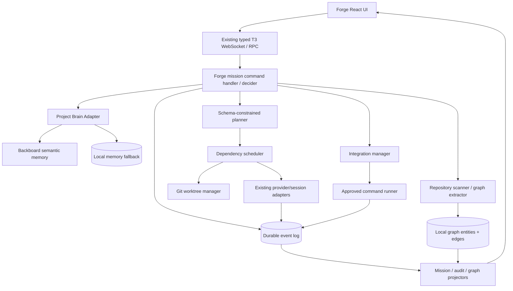

# T3 FORGE — FULL PRODUCT REQUIREMENTS & TECHNICAL DESIGN

**Version:** 2.0 | **Date:** 2026-10-09 | **Status:** Hackathon implementation specification / proposed design  
**Foundation:** Fork of [`pingdotgg/t3code`](https://github.com/pingdotgg/t3code)  
**Tagline:** **See what your coding agents know, share, change, and verify.**  
**Owner:** Hackathon team  
**Primary platform:** T3 Code web / desktop, with server-side ownership of workspace execution  
**Product stage:** Proposed; no feature in this PRD is claimed to have been implemented

> **Instructions for coding agents:** This is a product specification, not proof of existing APIs. Before modifying the fork, inspect the exact checked-out commit, `AGENTS.md`, `docs/internals/overview.md`, current provider/session APIs, contracts, persistence layer, and existing test conventions. Follow upstream patterns over suggested filenames in this document. Do not invent method names. Implement incrementally, run repository-native checks, and report evidence per milestone.

---

## 0. TL;DR / build contract

Build a **visible, memory-aware two-agent software development mission** on top of T3 Code. The user opens a repository, sees a source-backed component graph, gives a feature request, reviews a two-task plan, and starts two existing T3-supported coding agents in isolated Git worktrees. Their task status, contract handoff and acknowledgments, discoveries, graph changes, and verification outcomes are all visible in the UI and persisted in an auditable event stream. Backboard stores/retrieves persistent semantic project decisions; a local graph store provides code relationships. A real approved build/test command verifies the integrated work. Optional Laya routes trivial vs parallel tasks; Render can host a later read-only viewer.

**P0: five demonstrable promises**
1. **Memory:** A decision survives agent sessions and is visibly retrieved with provenance.
2. **Graph:** A component/file relationship is sourced to code and a real graph delta appears in the UI.
3. **Concurrency:** Two actual provider agent processes/sessions run in separate worktrees.
4. **Communication:** A structured backend-to-frontend API contract is transmitted, acknowledged, and used as a dependency gate.
5. **Verification:** A real command runs against the integration worktree and reports exit status/logs; the system never confuses an agent's claim with a passing test.

**Not P0:** a full IDE rewrite, Neo4j, large-scale AST call graphs, general agent swarms, automatic arbitrary merge resolution, autonomous cloud execution, expensive training, custom vector DB, mobile Forge UX, sophisticated model-based routing.

## 1. Executive summary

AI coding agents can implement features quickly but suffer from fragmented project knowledge and poor visibility into concurrent work. Today's developer often cannot tell which architectural decisions were used, which agents depend on each other, whether a discovery is real or guessed, or if generated code was genuinely verified.

T3 Forge extends **the existing T3 Code application**, rather than replacing its coding harness. It adds:
- **Project Brain:** semantic memory (Backboard with local fallback) and a simple source-backed repository relationship graph.
- **Mission orchestrator:** dependency-aware two-task planning, isolated Git worktrees, session execution, state tracking, integration.
- **Observable communication:** typed event handoffs, contracts, acknowledgments, causal links and immutable audit history.
- **Visualization:** two distinct interactive React Flow canvases: the *Knowledge Graph* and *Mission DAG*, plus a filterable Audit Timeline and Verification inspector.
- **Real validation:** approved project tests/builds, actual process output and optional bounded rework.

The intended winner-worthy demonstration is **cause and effect**: a previous design decision influences implementation; an agent discovers an API contract; another agent acknowledges it; the graph updates based on evidence; verification detects/validates the change. The UI must reflect genuine backend state, not fabricated animated progress.

## 2. Problem and hypothesis

### 2.1 User problems
- Agents forget decisions and prior errors across threads.
- Concurrent agent sessions can edit conflicting files or assume incompatible API contracts.
- Developers have limited visibility into agent decisions and inter-agent handoffs.
- Codebase knowledge is scattered in source files, Git history, LLM transcripts and human conversation.
- A completed chat response is not proof that source integration, build and tests succeeded.

### 2.2 Product hypothesis
A **small persistent project brain + dependency-aware two-agent orchestration + auditable events + source-linked graph** will make a multi-agent coding workflow easier to understand and more trustworthy than disconnected chats, even without a large autonomous swarm.

### 2.3 Target users
- Primary: developers and hackathon participants using T3 Code with multiple features to implement.
- Secondary: technical reviewers, teammates and judges who need evidence of decisions, coordination and testing.
- Not in initial scope: enterprise compliance administrators and production-scale multi-tenant SaaS operators.

### 2.4 Differentiation
Not “two agents” alone, not “RAG on files,” and not an ornamental dashboard. Differentiation is the **traceable chain**: memory → plan → collaboration → code change → graph evidence → verification → project memory. Competing products offer pieces of this, so we should never claim these individual concepts are novel.

## 3. Scope and priority matrix

| Priority | Feature | Acceptance bar |
|---|---|---|
| **P0** | Forge entry point | Existing T3 chat still works; user can open Forge for a project |
| **P0** | Repository scan | Project files/modules and selected imports/API links shown with source refs |
| **P0** | Persistent decisions | Write, list, retrieve and inspect a decision across sessions |
| **P0** | Knowledge Graph | React Flow with stable node IDs, edge provenance and incremental updates |
| **P0** | Mission planner | LLM generates constrained, schema-valid two-task plan that can be edited/approved |
| **P0** | Worktree isolation | Two agents work independently from same base commit |
| **P0** | Real agent execution | Start and monitor two supported provider sessions using existing T3 adapters |
| **P0** | Contract gating | Contract proposed, acknowledged; dependent action blocks until required acknowledgment |
| **P0** | Audit log | Real events persisted before broadcasts, filterable and causally linked |
| **P0** | Mission DAG | Shows truthful blocked/running/failed/completed states; no invented percentages |
| **P0** | Integration + verification | Safe integration, actual command exit code and captured logs |
| **P1** | One repair cycle | Failure routed to owning agent; retest once; bounded timeout and cost |
| **P1** | Event/graph replay | Reconstruct mission from persisted event sequence |
| **P1** | Laya routing | Classify single vs parallel with version and score + fallback |
| **P1** | Read-only deployment | Remote dashboard on Render; local runner remains source of execution truth |
| **P2** | Graphiti/Neo4j | Defer: costs more to integrate than lightweight graph tables |
| **P2** | Langfuse/complex tracing | Defer: audit needs only native event stream |
| **P2** | Full AST call graph | Defer: cross-language accuracy and dependency complexity |
| **P2** | Reviewer swarm, analytics, model training | Defer |

### P0 freeze rule
After the first successful two-agent end-to-end test, do not introduce another backend framework or hosted service. Spend remaining time improving graph clarity, error handling and demo reliability.

## 4. Personas, user stories and jobs to be done

**Developer:** “When I ask for a feature, I want to know which project rules apply, delegate independent components, and see if it passed real checks.”

**Technical judge:** “When a graph relationship or progress indicator appears, I want to click through to its real evidence.”

**Team collaborator:** “I need to inspect the message exchanged between agents, see who accepted the API contract, and distinguish proposal from implemented change.”

User stories:
- US-01: As a developer, I can scan a repository and browse its discovered modules and relationships.
- US-02: I can create an explicit project decision, and a later mission can retrieve it.
- US-03: I can ask for a feature, review a plan and start two separate agents.
- US-04: I can see why an agent is waiting and which event unblocks it.
- US-05: I can click any graph edge to inspect the file/line or other evidence.
- US-06: I can inspect structured messages between agents rather than only their chat transcripts.
- US-07: I can see build/test logs and exit codes, not a fabricated “100% success” score.
- US-08: I can stop a mission without deleting the main checkout or orphaning subprocesses.

## 5. Canonical hackathon demo

**Fixture repository:** small React + Node/Express + SQLite or Postgres demo project, stable dependencies, existing JWT auth, pre-existing profile screen, working test commands. Prefer a deterministic *profile editing* feature over an external OAuth provider. Fixture includes a seeded **explicit memory**: “Use the existing JWT auth service; do not introduce Auth0.”

**Target workflow**
1. Launch T3 Code fork with fixture repository; open Forge.
2. Scan repo, render relevant frontend/backend/auth nodes, source-backed IMPORTS/EXPOSES_API edges; click a provenance panel.
3. Show explicit stored decision with provenance from a prior session or user action; trigger fresh retrieval for feature task.
4. User prompt: **“Add an authenticated edit-profile feature; preserve the existing JWT architecture.”**
5. Planner yields `inspect & specify contract → backend and frontend in parallel → integrate → verify`; user approves.
6. Forge allocates two isolated Git worktrees at same base SHA and starts real provider sessions.
7. Backend proposes API contract (method/path/body/response); frontend acknowledges through event channel; orchestrator dependency gate changes state visibly.
8. Backend implements endpoint; frontend implements form. Show real emitted activity, changed files, and any evidence-based graph additions.
9. Integration step merges/applies changes in dedicated integration worktree and reports conflicts explicitly.
10. Approved command (`pnpm test` or fixture-specific test target) executes. Display command, duration, captured output, real exit code; optional deliberate test failure and one repair iteration if stable.
11. Present final mission evidence report: memory used, events, commit/worktree links, source-backed graph deltas, verification status, outstanding risks.

**Important demo semantics:** fixture seed is explicitly preloaded; any failing test must actually run; a replay is labeled recording; never pretend asynchronous work is live if it is precomputed.

**Suggested 4-minute narrative**
- 0:00–0:35: Repository brain and provenance.
- 0:35–1:00: Memory retrieval + approved mission plan.
- 1:00–1:50: Concurrent agents + actual contract exchange.
- 1:50–2:25: Live graph change + clicked source edge.
- 2:25–3:20: Integration + actual verification.
- 3:20–4:00: Audit causal chain and final evidence report.

## 6. Product information architecture / UI

### 6.1 Entry points
In an existing T3 project view, add a **Forge** entry point that opens a project-scoped workspace. Prefer adding within current navigation rather than restructuring upstream UI. Desktop uses the same web UI. Server remains sole owner of filesystem/provider credentials. Mobile-specific Forge controls are explicitly deferred; existing workflows must not break.

### 6.2 Primary screen layout
- **Left navigation:** Mission / Brain / Audit / Verification.
- **Header:** repo, environment, base commit, active mission, connection status.
- **Primary canvas:** interactive graph or event timeline.
- **Right inspector:** selected node, edge, task, agent, event or check; provenance and source navigation.
- **Bottom activity pane (optional):** bounded recent event stream; do not duplicate whole agent transcripts.

### 6.3 Knowledge Graph requirements
Use `@xyflow/react` with `Controls`, `MiniMap` (if graph size warrants), `Background` and custom node types. Render a **read-only evidence graph**, not a workflow editor.

Node types v1: `FILE`, `MODULE`, `API_ROUTE`, `SERVICE`, `DECISION`, `ISSUE`, `TEST` (some optional until proven extractor reliable). Edge types v1: `IMPORTS`, `EXPOSES_ROUTE`, `DEPENDS_ON`, `CONSTRAINED_BY`, `RELATED_TO`.

Interactive capabilities: pan/zoom, node click, edge click, source inspector, type filter, search by filename/label, highlighted newly discovered nodes/edges. On scanning again, update stable nodes instead of duplicating them.

**Evidence states**: `verified_static` (parser/source evidence), `explicit_human` (user authored), `inferred_unverified` (LLM hypothesis). Use distinct styles/legend. Do **not** depict inferred edges as hard verified facts. Show `first_seen` and current validity.

**Optional but strong P1:** “new since mission start” filter, small append event animation, replay event sequence. Avoid continuous expensive force-layout animation; compute layout only on structural changes, throttle UI deltas.

### 6.4 Mission DAG requirements
Separate graph from knowledge graph; nodes: Plan/Contract/Backend/Frontend/Integration/Verification. Each task node displays state, owning agent, unblock dependency and key timestamps. Status vocabulary: `draft`, `queued`, `blocked`, `running`, `completed`, `failed`, `cancelled`, `needs_review`. Do not show fabricated percentage complete.

Click node → agent session link, worktree path (sanitized), recent events, changed files, failure reason, logs link.

### 6.5 Audit Timeline requirements
Chronological with immutable server sequence, actor, recipient, event type, summary, `caused_by_event_id`, expanded sanitized structured payload, source and trace reference. Filters by task/agent/event type. Show proposal and acknowledgment separately. Optional causality highlights: select `CONTRACT_ACKNOWLEDGED` and see predecessor `CONTRACT_PROPOSED` and successor task-unblock event.

### 6.6 Verification Inspector
Show approved command, workspace, start/end, elapsed time, exit code, timeout flag, status, stdout/stderr excerpt, log artifact reference, test names/count only if parser verified. Green status only if process exits successfully **and** specified checks completed; warnings remain visible.

### 6.7 UX states
Empty project, scan in progress, scan failed, memory API unavailable, provider unavailable, worktree creation failed, plan invalid, task blocked, agent crashed, integration conflict, test timeout, tests fail, partial completion, user cancellation, recovered interrupted mission. Each state needs actionable text and an inspectable error.

## 7. System architecture and boundaries

### 7.1 Existing foundation (verify against checked-out revision)
Upstream T3 Code documents a Node WebSocket server, typed requests, command/event/projector architecture, CLI provider adapters, web/desktop/mobile surfaces, Git checkpointing, and shared contracts. Inspect the actual code before choosing extension seams. Docs: https://github.com/pingdotgg/t3code/blob/main/AGENTS.md and https://github.com/pingdotgg/t3code/blob/main/docs/internals/overview.md.

Do not make the client run local Git, read filesystem secrets or invoke provider executables. The workspace-owning T3 server remains authoritative. Avoid interfering with T3's hidden checkpoint refs and its existing thread lifecycle.

### 7.2 Proposed logical diagram



### 7.3 Architectural principles
1. **Reuse T3 command/event conventions**; don't create a parallel RPC architecture unnecessarily.
2. **Event first**: persist before broadcasting; projector/UI derives truth.
3. **Workspaces are environment local**; never execute arbitrary code on a viewer/client.
4. **Minimal graph semantics**: prefer a source-backed import/API graph to a speculative function call graph.
5. **No false guarantees**: tests prove a check ran and passed, not universal correctness.
6. **Adapters around external dependencies**: Backboard and Laya can fail independently without breaking mission visibility.
7. **Idempotent updates and stable IDs**: reconnects/replay don't duplicate graph nodes or events.
8. **Safe default**: human approval for executing commands, integration and pushing/merging to the user's main branch.

## 8. Proposed monorepo extension points

These are **suggested logical paths**, not confirmed existing modules:

```text
apps/server/src/forge/
  missions/mission-service.ts
  missions/planner.ts
  missions/scheduler.ts
  missions/worktree-manager.ts
  missions/integration.ts
  brain/repo-scanner.ts
  brain/graph-extractor.ts
  brain/backboard-adapter.ts
  brain/local-memory-adapter.ts
  brain/context-builder.ts
  events/forge-event-types.ts
  events/projection.ts
  verify/approved-command-runner.ts
  optional/laya-router.ts
apps/web/src/features/forge/
  ForgeShell.tsx
  MissionGraph.tsx
  KnowledgeGraph.tsx
  AuditTimeline.tsx
  InspectorPanel.tsx
  VerificationPanel.tsx
packages/contracts/src/forge/ (...typed DTOs / commands / event schemas)
packages/client-runtime/... (shared client projections only if required)
```

**Implementation note:** T3 may use Effect and Schema conventions; prefer established runtime dependency injection, typed contracts and state projection patterns. Consult relevant upstream maintainers' instructions; avoid adding heavyweight logic in `packages/contracts`.

## 9. Data model (proposed relational schema)

Use the fork's existing persistence approach if practical. Otherwise, add scoped SQLite tables within the T3 server's data store. Migration is required, not raw ad hoc JSON files for canonical mission state. IDs are UUID/ULID or stable hashes as noted; use transaction boundaries where specified.

### 9.1 Projects / environments
`forge_projects(project_id PK, environment_id, workspace_root, repo_remote_hash NULL, created_at, indexed_head_sha NULL, index_version)`

**Security:** keep absolute `workspace_root` server-side; UI may show sanitized relative path. `project_id` must bind data to one environment and prevent cross-project memory/graph leakage.

### 9.2 Missions
`forge_missions(mission_id PK, project_id FK, user_request, base_sha, integration_worktree_id NULL, state, plan_version, created_at, started_at NULL, finished_at NULL, requested_by)`

### 9.3 Tasks
`forge_tasks(task_id PK, mission_id FK, title, objective, role, state, provider_id NULL, thread_id NULL, worktree_id NULL, attempts DEFAULT 0, created_at, started_at NULL, finished_at NULL, last_error NULL)`

`forge_task_dependencies(task_id FK, depends_on_task_id FK, gate_type ENUM('completed','contract_acknowledged','manual_approval'), gate_ref NULL, PRIMARY KEY(...))`

Invariants: DAG acyclic; tasks can't move to running until all gates satisfied; terminal tasks can't silently revert; each running task has only one active execution owner.

### 9.4 Worktrees
`forge_worktrees(worktree_id PK, mission_id FK, task_id NULL, path_internal, branch_ref, base_sha, head_sha NULL, state ENUM('created','active','ready','integrated','abandoned','cleanup_pending'), created_at)`

Never delete worktrees holding uncommitted user data without confirmation. Worktree creator must use `git worktree add` with shell-safe arguments through an exec API (not string concatenation).

### 9.5 Graph entities
`forge_graph_nodes(node_id PK, project_id FK, kind, label, source_ref NULL, source_version NULL, metadata_json, evidence_status, validity, first_seen_at, last_seen_at)`

`forge_graph_edges(edge_id PK, project_id FK, source_node_id FK, target_node_id FK, relation, evidence_kind, evidence_ref, evidence_payload_json NULL, evidence_status, validity, first_seen_at, last_seen_at)`

Unique identity: deterministic source-grounded IDs; `edge_id = stable_hash(project, source_node, target_node, relation, evidence_source_key)`. This allows multiple evidences for a relation while avoiding duplicates from rescans.

### 9.6 Memories
`forge_memories(memory_id PK, project_id FK, category ENUM('decision','issue','preference','architecture_note'), text, source_ref, source_actor, evidence_status, active BOOLEAN, backend ENUM('backboard','local'), remote_id NULL, created_at, superseded_by NULL)`

**Backboard isolation:** each project must have its own configured `assistant_id` (or equivalent supported memory scope); never share one assistant across unrelated repositories. Store mapping locally and protect keys. Backboard's documented memory modes require appropriate per-turn config, and manual memory APIs exist. Confirm SDK/API version at implementation time.

### 9.7 Event log
`forge_events(event_id PK, mission_id FK, project_id FK, sequence INTEGER, event_type, actor_id, recipient_id NULL, task_id NULL, occurred_at, caused_by_event_id NULL, schema_version INTEGER, payload_json, source_ref NULL, UNIQUE(mission_id,sequence))`

Allocate `sequence` transactionally. Append only. Corrections create new events. Large stdout/stderr artifacts go into separately bounded storage with references, never full secret-bearing transcripts in event payloads.

### 9.8 Verification runs
`forge_verification_runs(run_id PK, mission_id FK, worktree_id FK, command_id, argv_json, relative_cwd, state, started_at, finished_at, exit_code NULL, timeout BOOLEAN, log_artifact_id NULL, parsed_summary_json NULL)`

### 9.9 Example event payloads

```json
{
  "event_id": "evt_001",
  "mission_id": "mis_001",
  "sequence": 17,
  "event_type": "CONTRACT_PROPOSED",
  "actor_id": "agent_backend",
  "recipient_id": "agent_frontend",
  "task_id": "task_backend",
  "caused_by_event_id": "evt_014",
  "payload": {
    "contract_id": "profile-api-v1",
    "method": "PATCH",
    "path": "/api/profile",
    "request_schema": {"displayName": "string"},
    "response_schema": {"id": "string", "displayName": "string"},
    "version": 1
  }
}
```

```json
{
  "event_id": "evt_002",
  "mission_id": "mis_001",
  "sequence": 18,
  "event_type": "CONTRACT_ACKNOWLEDGED",
  "actor_id": "agent_frontend",
  "recipient_id": "agent_backend",
  "task_id": "task_frontend",
  "caused_by_event_id": "evt_001",
  "payload": {"contract_id": "profile-api-v1", "version": 1}
}
```

## 10. Event taxonomy and state machines

### 10.1 Required event taxonomy
- Mission: `MISSION_CREATED`, `PLAN_PROPOSED`, `PLAN_APPROVED`, `MISSION_STARTED`, `MISSION_CANCELLED`, `MISSION_FINISHED`.
- Tasks: `TASK_QUEUED`, `TASK_BLOCKED`, `TASK_STARTED`, `TASK_PROGRESS_RECORDED`, `TASK_COMPLETED`, `TASK_FAILED`, `TASK_CANCELLED`.
- Agents/contracts: `AGENT_SESSION_STARTED`, `AGENT_SESSION_ENDED`, `CONTRACT_PROPOSED`, `CONTRACT_ACKNOWLEDGED`, `CONTRACT_REJECTED`, `DISCOVERY_RECORDED`.
- Brain/graph: `MEMORY_RETRIEVED`, `MEMORY_CREATED`, `MEMORY_SUPERSEDED`, `GRAPH_NODE_UPSERTED`, `GRAPH_EDGE_UPSERTED`, `GRAPH_EDGE_INVALIDATED`.
- Integration/verification: `INTEGRATION_STARTED`, `INTEGRATION_COMPLETED`, `MERGE_CONFLICT_DETECTED`, `VERIFICATION_STARTED`, `VERIFICATION_PASSED`, `VERIFICATION_FAILED`, `VERIFICATION_TIMED_OUT`.
- Recovery: `MISSION_INTERRUPTED`, `TASK_RECONCILED`, `EXTERNAL_SERVICE_UNAVAILABLE`.

Not every CLI token streamed by the agent should be a persisted event. Persist **meaningful state transitions**, bounded progress summaries and references to logs; otherwise performance and storage suffer.

### 10.2 Mission state machine
`draft → approved → running → (integrating → verifying) → completed / needs_review / failed / cancelled`.

Only server commands trigger state transitions. Clients receive projected state. `completed` means requested checks passed and the integration result is available; it does not mean the user's main branch was forcibly merged.

### 10.3 Task state machine
`queued → blocked/running → completed/failed/cancelled`; recovery may mark `interrupted`, then `queued` after explicit or safe reconciliation. Gates must be checked atomically before scheduling.

### 10.4 Causality
A front-end unblock event must reference the contract acknowledgment that permitted it. Verification failure must reference its run and integration commit. An appended knowledge graph edge must reference a source file, commit, human decision or event. Unverified model guesses remain separate and labeled.

### 10.5 Replay
Read all events for one mission ordered by `sequence` and apply deterministic projectors. Verify that snapshot state equals replayed state. Support idempotent frontend reconnect by last received sequence; request missing tail events, never silently skip.

## 11. Project Brain specification

### 11.1 Initial indexing
- Resolve repo root using T3 environment/project state.
- Enumerate tracked files with `git ls-files` (plus selected untracked files only with consent), excluding secrets, credentials, `.env`, vendor/build outputs, binary files and oversized files.
- Extract file/folder/modules; selected TypeScript/JavaScript static imports using TS compiler API or Tree-sitter only if already practical; detect selected Express routes when syntactically grounded.
- Create deterministic node IDs, import/route edges and source references with commit SHA/path/line.
- Emit graph delta events; persist graph changes and publish to UI.
- Incremental indexing: compare HEAD and changed files; rescan affected files and invalidate edges whose evidence no longer exists.

**Do not parse entire huge repositories for the hackathon.** Set max tracked files, maximum file size and batching; display `partial_index` state with limits rather than claiming completeness.

### 11.2 Semantic memory with Backboard
Backboard adapter interface (abstract contract, not an upstream API assertion):

```ts
interface ProjectMemoryPort {
  put(input: MemoryWrite): Promise<StoredMemory>;
  search(input: { projectId: string; query: string; limit: number }): Promise<MemoryHit[]>;
  list(projectId: string): Promise<StoredMemory[]>;
  supersede(projectId: string, id: string, replacement?: MemoryWrite): Promise<void>;
}
```

- `BackboardProjectMemoryAdapter`: scoped assistant per project, manual memory CRUD/search where supported, retries with exponential backoff, short request timeout, provider status indicator.
- `LocalProjectMemoryAdapter`: simple SQLite keyword/FTS retrieval and explicit memory store; no embeddings required for demo fallback.
- Only write explicit user-decisions automatically; LLM-extracted memories are candidates requiring approval or a clearly labeled lower evidence status.
- Bound content size and retrieval count; sanitize secrets. Show exact memory items injected into each agent context packet.
- Context packet should contain source references, timestamps, text, confidence status and user-override directives; never include raw Backboard credentials in provider prompts.
- Retrieval failure should degrade to no external memory rather than prevent mission scheduling.

### 11.3 Context builder
For each agent task:
1. Add concise task objective and approved API contract.
2. Add relevant project memory (e.g., top 3–6 hits) with provenance.
3. Add source-grounded related files/modules and reason for relevance.
4. Add cross-agent dependency status and nonnegotiable constraints.
5. Cap token budget, truncate/omit low-value history, log `MEMORY_RETRIEVED` with IDs, not entire secret-bearing context.

Do not inject every memory into every agent. Frontend and backend should receive tailored context.

### 11.4 Graph append/upsert rules
- Scanner emits `candidate node/edge + evidence`.
- Normalize path and compute stable ID.
- Validate referenced source exists and evidence is consistent with current indexed SHA.
- Insert or update same stable ID transactionally; publish delta **after durable commit**.
- If evidence removed, mark relation `invalidated`; keep history in events.
- If agent claims a new relation without verifying code, store `inferred_unverified` only and render dashed/different style.
- Two agents producing same relation should consolidate evidence instead of creating duplicate visual nodes.

## 12. Mission orchestration and isolation

### 12.1 Planning contract
Structured planner output, schema validated before use:

```json
{
  "mission_title": "Authenticated profile editing",
  "project_constraints": ["Preserve existing JWT auth"],
  "contract": {"method":"PATCH","path":"/api/profile"},
  "tasks": [
    {"id":"backend","title":"Implement profile API","role":"backend","dependencies":["contract_acknowledged"]},
    {"id":"frontend","title":"Implement edit form","role":"frontend","dependencies":["contract_acknowledged"]}
  ],
  "verification_commands": ["fixture:test"]
}
```

Use stable IDs and explicit dependency mapping; reject cycles, unknown task kinds, unsafe commands, unbounded tasks and arbitrary >2 agent plan in P0. A planner might propose an initial contract, but an actual `CONTRACT_ACKNOWLEDGED` event must occur to unblock dependent work.

### 12.2 Worktrees
- Require clean base commit or clearly disclose dirty baseline. Never overwrite user changes.
- `git worktree add --detach <safe-path> <base-sha>` or isolated branches following existing repo conventions.
- Per-task worktrees under designated Forge-managed directory.
- Record `worktree_id`, actual base SHA, branch/ref, path internal only, and task ownership.
- Agents run in their worktree process cwd, not the user's main checkout.
- Limit concurrent agents to 2; file ownership guidance reduces conflicts but is advisory.
- On cancellation, stop only child processes started by Forge using captured process/session handles. Never broad-pattern kill commands.

### 12.3 Agent execution
Use provider adapters already present in T3 Code; inspect which provider/session APIs can accept a working directory and expose lifecycle/activity events. If that capability doesn't exist, implement the smallest compatible extension rather than adding another agent SDK. Choose **one working provider** initially; do not spend time normalizing every adapter for the demo.

Agent telemetry in P0: provider, task ID, started/stopped, last meaningful activity, changed file list, failure reason, session link. Avoid raw token stream persistence unless already provided securely.

### 12.4 Contract handoff
- Backend agent or planner proposes a structured API contract.
- Contract gets versioned and stored as an event.
- Frontend receives it and emits a matching versioned acknowledgment.
- The appropriate scheduler gate moves from blocked to ready **only after acknowledgment**.
- Later contract changes require a new version and re-acknowledgment before dependent integration work. A stale acknowledgment is invalid.

### 12.5 Integration strategy
P0 use a **dedicated integration worktree** created from base SHA. Combine both task results via explicit commits/cherry-picks or safe patch application. If agents left uncommitted modifications, use a controlled snapshot/commit action after permission and report it transparently; don't silently rewrite their branches. Apply backend then frontend, detect conflicts, pause for review. Never force push/reset the developer's main checkout.

Integration record links task heads, base SHA, integration SHA and conflict details. Verify the **integrated** code, not merely each agent worktree separately.

### 12.6 Cancellation/restart recovery
Persist mission/task/worktree records before spawn; on startup reconcile running tasks using T3's existing session mechanism or captured process ownership. If uncertain, mark `interrupted/needs_review` rather than launch duplicate agents. Keep worktrees until the user approves cleanup. Preserve audit records across restart.

## 13. Verification and optional repair

### 13.1 Approved command model
Commands must come from a project fixture's allowlist or user-approved configuration. Never execute shell text blindly from an LLM. Store structured `argv` arrays, cwd relative to integration root, timeout and resource caps; run subprocess without shell interpolation where feasible. Do not execute unknown repo `postinstall` scripts in an unrestricted high-trust environment without warning.

### 13.2 Output collection
Capture bounded stdout/stderr, exit code, start/end time, timeout flag and environment summary (no secrets). Log may be stored in an artifact file referenced by ID. `PASSED` only if exit code 0 and all mandatory checks have completed; `FAILED`, `TIMEOUT`, `NOT_RUN` must be distinct.

### 13.3 Test parsing
If using Vitest/Jest, parse structured machine-readable output where possible; otherwise show raw process exit status and log excerpt only. Never invent test counts or coverage.

### 13.4 Repair (P1)
On failure, create a bounded fix task with relevant log excerpt, suspected file links, contract state and task owner. Max one loop initially. Re-integrate safely; rerun mandatory checks. Surface unresolved failures without claiming success. Cap retries, runtime, and cost.

## 14. Optional Laya decision adapter (P1)

Laya should **not** be an execution engine, test runner or core planner. Use it solely for one bounded structured choice: `single_agent` vs `parallel_two_agents`, optionally basic risk class. Provide deterministic fallback when model not installed, crashes or score below configured threshold.

Log: model/version/checkpoint, sanitized prompt summary, candidate choices, scores, selected route, fallback reason and human overrides. Benchmark against a small labeled set (e.g., 20 curated tasks) before claiming improvement. Avoid routing sensitive/critical changes solely on model confidence.

If the exact Node/ONNX integration proves incompatible with the fork, remove Laya from demo rather than delaying P0. Tinker fine-tuning is excluded.

## 15. Contracts / transport (proposed)

**Names below are design suggestions**, to be mapped into existing typed command/effect schemas. Avoid spinning up independent HTTP routes when T3's authenticated RPC is appropriate.

Command intents:
- `forge.project.scan({projectId, options})`
- `forge.memory.add({projectId, category, text, sourceRef})`
- `forge.memory.search({projectId, query, limit})`
- `forge.mission.plan({projectId, request})`
- `forge.mission.approve({missionId, planVersion})`
- `forge.mission.start({missionId})`
- `forge.mission.cancel({missionId})`
- `forge.contract.acknowledge({missionId, contractId, version, taskId})`
- `forge.integration.begin({missionId})`
- `forge.verification.run({missionId, approvedCommandId})`

Read projections:
- `forge.project.getGraph(projectId)`
- `forge.mission.get(missionId)`
- `forge.mission.list(projectId)`
- `forge.events.list(missionId, fromSequence, limit)`
- `forge.verification.get(runId)`

Updates should flow over existing authenticated subscription/replay conventions. Authorization: ensure caller is allowed to access the owning environment/project; never expose paths, creds or other users' records across sessions.

### API error vocabulary
`PROJECT_NOT_FOUND`, `PROVIDER_UNAVAILABLE`, `PLAN_SCHEMA_INVALID`, `TASK_DEPENDENCY_CYCLE`, `CONTRACT_VERSION_MISMATCH`, `WORKTREE_DIRTY_BASE`, `WORKTREE_CREATION_FAILED`, `MISSION_CONFLICT`, `MEMORY_SERVICE_UNAVAILABLE`, `VERIFICATION_NOT_APPROVED`, `VERIFY_TIMEOUT`, `INTEGRATION_CONFLICT`, `MISSION_INTERRUPTED`.

Return structured actionable error, not only text.

## 16. Security, privacy and cost controls

### 16.1 Trust boundaries
- External tool/LLM output, repository README/comments, Git commit messages, test output and Backboard memory are **untrusted input**.
- Prompt injection cannot grant shell, delete, publish or credential access. Commands require server authorization and allowlist/explicit approval.
- Sanitize Markdown/rendered logs; no executable HTML from agent messages.
- Store API keys only in backend secret configuration; never embed Backboard credentials in browser bundles.

### 16.2 Secret redaction
Redact environment variables, known token patterns and configured secrets from event payloads and logs before durable write and broadcast. Exclude `.env`, credentials, SSH keys and generated auth caches from indexing/upload. Provide explicit notice before sending repository-derived text to a hosted provider.

### 16.3 Filesystem and process safety
- Restrict worktree paths under approved managed directory; canonicalize to prevent traversal.
- Never run `pkill -f`/pattern-based process killing; use captured child PID/session handle per upstream warnings.
- Never launch a dev server against live `~/.t3/userdata`; use isolated test data.
- Avoid configuring `VITE_HTTP_URL` or `VITE_WS_URL` in upstream dev path, as per T3 maintainer guidance.
- No automatic force merge, force push, destructive reset or cleanup of user-owned worktree changes.

### 16.4 Budget limits
Configure per mission: max agents 2, max execution time per task, max test command runtime, max memory lookups, max model calls, max repair attempts. Track estimated provider spend if available; don't invent token cost where provider doesn't expose it.

### 16.5 External services
Backboard is an optional hosted supporting API, not proof of open-source functionality. Preserve a local memory fallback for demo reliability and open-source reproducibility. Render/other cloud providers should host only a properly authenticated read-only projection if the code runner stays on a laptop. Do not expose a local test runner directly to the public internet.

## 17. Open-source components and giveaway allocation

| Need | Reuse | Rationale | Status |
|---|---|---|---|
| Coding UI, agents, remote server | T3 Code upstream fork | Preserve runtime and provider adapters | **P0** |
| Interactive graphs | [`@xyflow/react`](https://github.com/xyflow/xyflow) | Custom nodes, edges, viewport, performance | **P0** |
| Persistent semantic memory | [Backboard API](https://docs.backboard.io/sdk/memory) | Hackathon $5 credit; typed API and cross-session memory | **P0 with fallback** |
| Graph persistence | Existing DB / SQLite | No full graph DB needed | **P0** |
| Git worktrees | Native Git | Real isolation and integration | **P0** |
| Project verification | Existing build/test runner | Actual evidence | **P0** |
| Mission decision routing | Laya open-weight model | One structured route choice | **P1** |
| Cloud dashboard | Render $50 credit | Public read-only demo once core works | **P1** |
| Domain | .tech free year | Optional branding | **P1** |
| DigitalOcean $25 | Alternative remote runner | Don't add second deployment platform by default | **Reserve** |
| Tinker $10 | Model fine-tuning | No time or need to fine-tune for MVP | **Cut** |

**Offer limits:** verify expiration, account eligibility and allowed usage from the actual giveaway page before claiming or depending on credit.

## 18. Performance and reliability requirements

These are **targets for local fixture testing**, not promised measured results.
- UI graph should remain interactive with at least ~150 visible nodes / ~300 edges on a typical hackathon laptop; cap incremental updates/throttle animations.
- Persist/broadcast meaningful event within ~1s of receipt under local conditions; maintain order by sequence.
- Reconnections must not duplicate graph entities/events or lose events after last confirmed sequence.
- Startup with Backboard offline must still allow viewing previously indexed graph and existing mission history.
- A worktree failure must show a failed task and not corrupt or overwrite user's main working tree.
- A test runner timeout must terminate its own process tree safely and record `VERIFICATION_TIMED_OUT`.
- Memory retrieval errors shouldn't block coding-agent execution, but should be visible in audit.

## 19. Acceptance criteria / definition of done

### AC-01 Repo graph
Given a fixture repo with known imports, scanning shows at least 5 source-grounded nodes and 3 source-grounded edges; selecting one edge displays a valid local file/line reference.

### AC-02 Idempotent scan
Running the same scan twice at same commit does not increase node/edge counts from duplicates; changing an import updates or invalidates appropriate edge.

### AC-03 Memory persistence
Decision created in session A can be listed/retrieved in session B in same project; project B does not receive that decision. Retrieval event records selected memory IDs. Backboard outage triggers explicit fallback.

### AC-04 Plan validation
A plan with a cycle/third parallel worker/unknown dependency is rejected with meaningful error; approved plan is persisted.

### AC-05 Two real agents
Two supported agents start in distinct worktree directories from same base commit. Original checkout does not change during execution. Provider session IDs are traceable.

### AC-06 Contract gate
Before matching version acknowledgment, dependent task remains blocked; `CONTRACT_ACKNOWLEDGED` triggers unblock. Old acknowledgment cannot satisfy a new contract version.

### AC-07 Audit integrity
Every event has unique ID and ordered mission sequence; refreshed UI reconstructs identical task and audit state. Actor and causal parent are inspectable for handoff event.

### AC-08 Graph live delta
A verified new relation emits persisted update and appears in UI without manual refresh. Edge inspector points to its source; an inferred relation is visually marked unverified.

### AC-09 Integration safety
Changes combined in integration worktree. Conflicts produce visible `needs_review` with conflict details; main user checkout not force-overwritten.

### AC-10 Real verification
Approved command executes and logs true exit status; nonzero exit is never displayed as pass; timed-out run is distinct. Optional repair cannot exceed configured retry count.

### AC-11 Crash/cancel
Cancel stops known Forge-owned agent child sessions only; restart recovers state or marks `interrupted` without duplicate spawning.

### AC-12 Demonstration honesty
Every live demo status comes from backend real state; mock/seed/replayed content visibly labeled. Final report differentiates tests run, skipped and incomplete.

## 20. Test plan

| Layer | Examples |
|---|---|
| Unit | Graph stable IDs, schema validation, DAG cycle detection, dependency gates, memory adapter fallback, event reducers |
| Persistence | Unique event sequence, replay equivalence, memory scoping, idempotent graph UPSERT |
| Integration | Git worktrees from fixture, provider cwd wiring, contract ack dispatch, safe cherry-pick conflict |
| E2E UI | Open project → scan → graph inspector → plan → run → audit → verify |
| Failure injection | Backboard unavailable, second agent crashes, stale contract, merge conflict, test exit 1, timeout |
| Security | Path traversal, secret in log, prompt injection inside README, unauthorized project ID, dangerous shell command |
| Performance | Burst of 100 events, 150-node graph UI, reconnect + catch-up |

**Evidence artifact requirements:** record commands executed, check statuses, test output paths, failing/recovered cases, and screenshot/recording of core demo. Don't claim tests passed until actually executed.

## 21. Delivery plan / milestones

Milestones are ordered by risk, not aesthetics. Do a technical spike before promising time estimates.

### M0 — Upstream discovery (first)
- Inspect exact fork revision, T3 agent/session dispatch, working-dir controls, event/projector persistence, contracts and package scripts.
- Start fork cleanly; run baseline unit/lint/type checks.
- Pick one reliable provider for demo; verify how to bind a distinct working directory to each session.
- Create fixture repo and validate its build/test flow.

**Exit gate:** documented extension seams + successful single provider session in fixture.

### M1 — Parallel execution spike (highest risk)
- Implement two worktrees, two real sessions and minimal per-task statuses.
- Run both agents on intentionally non-overlapping files; verify source isolation.

**Exit gate:** evidence of two independently running/finished provider sessions in separate worktrees.

### M2 — Events + Mission DAG
- Add mission/tasks/dependencies/events schemas and store/projectors.
- Implement two-agent plan, contract proposal/ack gate, audit inspector.
- Render mission DAG; refresh/reconnect recovery test.

**Exit gate:** one real agent communication event changes another task's scheduling state.

### M3 — Brain + Live Graph
- Add repo scanner, graph store/upsert, React Flow canvas and evidence inspector.
- Integrate Backboard memory adapter with local fallback; show retrieved decision per task.

**Exit gate:** graph genuinely updates and explicit memory influences context packet.

### M4 — Integration + verification
- Dedicated integration worktree, conflict-safe source consolidation.
- Approved test command runner and real verification view.

**Exit gate:** end-to-end mission with real integrated build/test evidence.

### M5 — Demo hardening / stretch
- Robust empty/errors, graph highlights, audit causal links, one repair retry.
- Optional Laya routing or hosted viewer only after everything above works.
- Screen recording and backup replay clearly labeled.

**Exit gate:** 3 consecutive deterministic fixture demos without destructive side effects.

## 22. Priority-based cut strategy

**If only ~6–8 hours:** Deliver existing T3 Code + repository graph + explicit memory + audit of one real agent session; pitch parallel agents as subsequent work, do not imply completed.

**If ~12–18 hours:** Focus on 2 real agent worktrees + contract event + mission DAG + basic graph + real test. Backboard memory can be simplest manual CRUD/search.

**If ~24–36 hours:** Add graph deltas, robust provenance, failure handling, optional one repair loop and Laya if stable. Hosted Render viewer only if time remains.

In any schedule, **never sacrifice actual execution for more visual mockups**.

## 23. Ownership, team split and task dependencies

For a small hackathon team (adjust to size):
- **Engineer A — server/agents:** inspect T3 server/provider hooks, implement session cwd/worktree manager and scheduler.
- **Engineer B — visuals:** React Flow Knowledge/Mission canvases, audit inspector, states and evidence panel.
- **Engineer C — memory/data:** scanner, graph store, Backboard adapter, typed schemas and tests.
- **Engineer D or shared — integration/verification/demo:** build/test runner, fixture repo, contract gates, release/demo hardening.

Agree on event + DTO contracts **before** parallel implementation. Create test fixture and Graph/Event sample payloads early so UI doesn't depend on unfinished backend.

## 24. Metrics and evaluation

**Capture, don't invent:**
- End-to-end mission completion time.
- Number of concurrently active agent sessions and overlap duration.
- Number of contract proposal/acknowledgment events and unblock latency.
- Number of graph entities and edges with valid evidence.
- Number of memories retrieved and used in context packets.
- Tests/checks truly run, passed, failed, skipped.
- Number of manual interventions, unresolved failures, merge conflicts.
- Provider call/runtime estimate if available.

**Stretch evaluation:** Run same fixture feature with one agent vs two agents and with memory disabled vs enabled. Do not claim universal speed gains from one fixture run; describe results as observed case studies.

## 25. Risks, mitigations and open decisions

| Risk | Severity | Mitigation |
|---|---|---|
| Provider API cannot set distinct cwd | Critical | M0/M1 spike, smallest compatible adapter change, one provider first |
| Agents conflict on shared files | High | Planned file ownership, separate worktrees, explicit integration review |
| Graph contains invented edges | High | Source refs, verified/inferred status, deterministic extractor |
| Backboard credit/latency unavailable | Medium | Local SQLite memory fallback, short timeouts |
| Audit overwhelms database/UI | Medium | Persist state transitions, link large logs, throttle UI |
| Test execution changes host state | High | Safe fixture, approved commands, timeouts, ideally sandbox/container |
| Laya performance/availability | Low for P0 | Keep optional, deterministic fallback |
| Upstream T3 changes | High | Pin commit and check actual docs/code before implementing |
| Render cannot run local agent workspaces | Medium | Local runner, deploy read-only viewer only |
| Demo depends on external OAuth | Medium | Use local deterministic profile feature fixture |
| Reviewers mistake sample for live | High reputation risk | Explicit labels, execute real mission and real tests |

**Unresolved decisions to settle before coding:**
1. Exact checked-out T3 commit / provider adapter APIs.
2. Whether existing T3 persistence can safely host Forge tables or needs a minimal adjacent SQLite database.
3. Choice of the single supported provider for hackathon demo.
4. Fixture stack and approved verification commands.
5. Whether a cloud viewer is actually required by contest rules.

## 26. Judge-facing pitch and presentation copy

**One line:** “T3 Forge is an observable multi-agent coding workspace where agents share persistent project knowledge and every collaboration, code dependency, and verification result is inspectable.”

**30-second pitch:** “AI coding tools write code, but developers still have to repeat context, coordinate disconnected agents and trust unverifiable completion messages. T3 Forge builds on T3 Code to give agents a shared project brain, run two coding tasks in parallel, and expose a live graph of the project and a replayable audit log of agent handoffs. When agents finish, Forge runs real tests against the integrated result. You can see not just the output, but how the system arrived there and whether it passed.”

**Judge proof points:**
1. A stored decision changes the agent's instructions.
2. Two agent sessions truly execute in isolated worktrees.
3. A versioned contract acknowledgment unblocks a dependent task.
4. A graph relationship is source-backed and has a visible append/update event.
5. Real integration tests run; failures are not disguised as success.

## 27. Implementation instructions / coding agent bootstrap

Use this prompt with the PRD attached:

> You are implementing T3 Forge in my fork of T3 Code. First audit the checked-out repository and read its `AGENTS.md` and internal architecture. Do not assume the proposed paths or APIs in this PRD exist. Produce a short repo-specific integration map and implement milestone M0/M1 first: verify one provider can run in two separate worktree directories from a single mission. Preserve existing T3 functionality, use its typed event/RPC contracts and server-side ownership, and avoid new heavy dependencies. After each milestone, run the native checks and report exactly which files changed, what tests were executed, and what is still incomplete. Do not fabricate agent activity, graph relationships or verification outcomes. Stop and report blockers instead of replacing required functionality with UI mocks.

### Immediate first tasks for coding agent
1. Inspect existing server dispatch and provider working-directory lifecycle.
2. Verify separate worktree/session execution through a minimal test fixture.
3. Map upstream persisted event and projector patterns to Forge mission/events.
4. Define typed task/mission/audit/graph DTOs matching actual code conventions.
5. Only then start React Flow visuals, Backboard adapter, and verification workflow.

## 28. Sources and further reading

These are technical references, not confirmation of code already existing in your particular fork:

- [T3 Code upstream repository](https://github.com/pingdotgg/t3code)
- [T3 Code AGENTS.md](https://github.com/pingdotgg/t3code/blob/main/AGENTS.md)
- [T3 Code internal architecture](https://github.com/pingdotgg/t3code/blob/main/docs/internals/overview.md)
- [React Flow repository](https://github.com/xyflow/xyflow)
- [Backboard memory SDK documentation](https://docs.backboard.io/sdk/memory)
- [Backboard memory create endpoint](https://docs.backboard.io/api-reference/memories/add)
- [Git worktree documentation](https://git-scm.com/docs/git-worktree)

---

**END OF SPECIFICATION — T3 FORGE v2.0**
